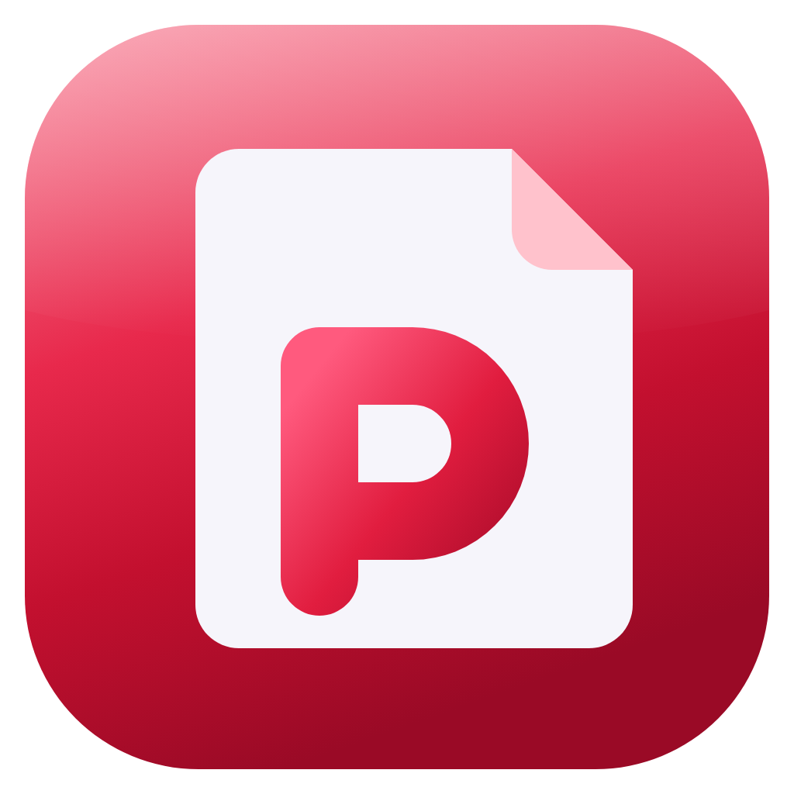
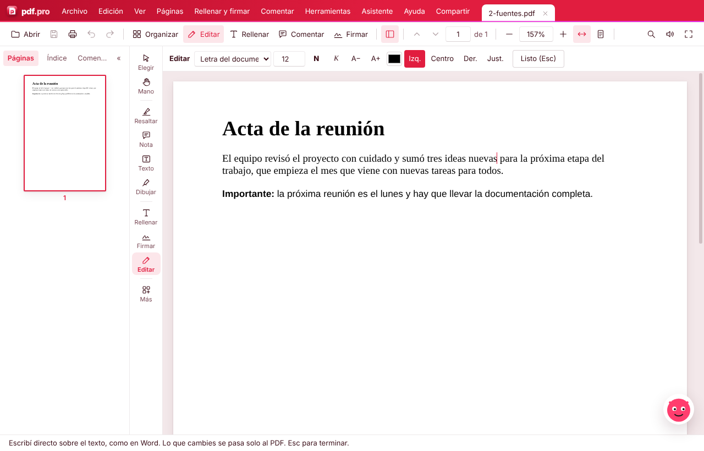
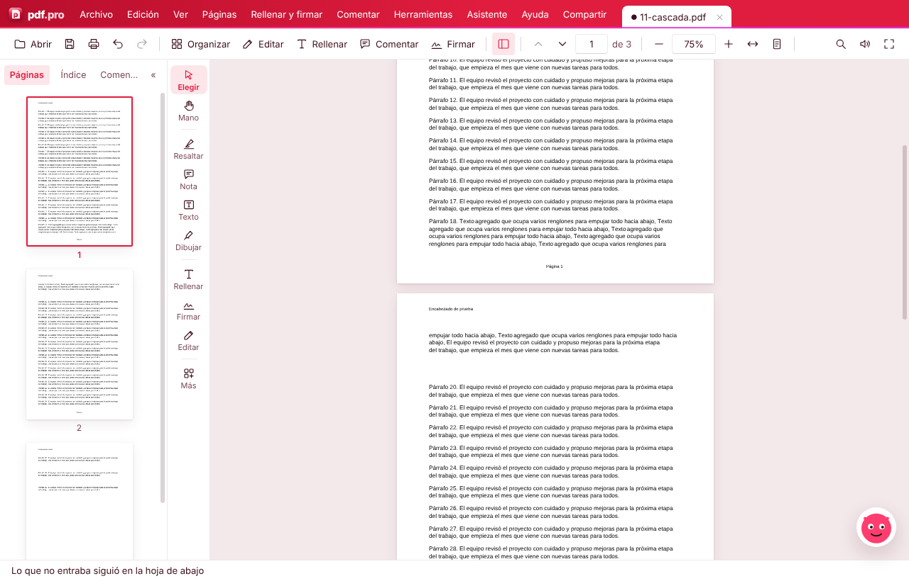
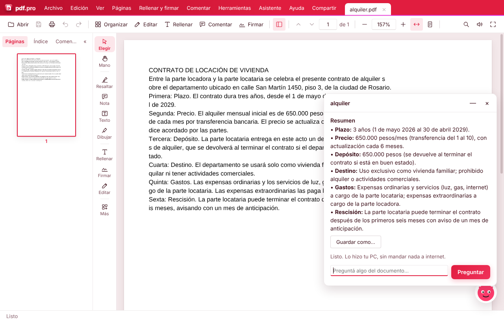

<p align="center"></p>

<h1 align="center">pdf.pro</h1>

<p align="center"><b>El editor de PDF que edita como Word.</b><br>
Gratis, en castellano, para Windows. Con asistente de IA que también funciona sin internet.</p>

<p align="center"><a href="https://github.com/tvmaty2186/pdf-pro-versiones/releases/latest/download/PDF.Pro-Instalar.exe"><b>⬇ Descargar para Windows</b></a> · <a href="https://tvmaty2186.github.io/pdf-pro/">Página del proyecto</a></p>

---

## Un editor distinto a todo lo que hay

Los editores de PDF de siempre (Acrobat incluido) tratan cada renglón como una cajita suelta: si agregás texto, se pisa con lo de abajo o se corta, y tenés que acomodar todo a mano.

**pdf.pro edita la hoja como un documento de verdad:**

- **Escribís sobre el texto como en Word**, con la misma letra, tamaño y color del original. No hay cajitas: el párrafo se reacomoda solo.
- **Si lo que escribís no entra, sigue en la hoja de abajo.** Y si esa también se llena, pasa a la siguiente, en cascada, hasta donde haga falta. Acrobat no lo hace: ahí el texto que sobra se pisa con lo de abajo o se sale de la hoja.
- **Respeta encabezados y pies de página**: quedan fijos en su lugar mientras el texto corre.
- **Lo demás no se toca**: el resto de la hoja queda idéntico, como lo verifican las pruebas automáticas en cada versión.





## Todo lo demás

- **Rellenar formularios** escribiendo derecho sobre los renglones, con ✓, ✗ y la fecha de hoy. "Repetir hacia abajo" copia una fila en toda una planilla, con las fechas que avanzan solas.
- **Firmar** con tu firma o sello guardados, con un clic. La foto de la firma se limpia sola (sin fondo).
- **Asistente de IA** (Claude, Gemini o **sin internet**, con un modelo que corre en tu PC): completa formularios con tus datos, aprende de tus ejemplos, resume y responde preguntas. El resumen se guarda como Word o PDF, y trabaja en segundo plano mientras seguís usando el programa.
- **Reconocer texto (OCR)** con PaddleOCR, sin internet: marcás una parte de un escaneo o una foto y copiás su texto, con tildes y eñes.
- **Organizar páginas**: mover, girar, borrar, insertar, separar, unir varios PDF.
- **Comprimir, numerar, quitar hojas en blanco, reparar, censurar** (borra de verdad), proteger con contraseña.
- **Pasar a Word y Excel**, y crear PDF desde fotos, Word, Excel o PowerPoint.
- **Copia editable de un PDF con firma digital**.
- Buscar cualquier comando con **Ctrl+K**, leer en voz alta, modo oscuro, actualizaciones automáticas.



## Descargar

[**PDF.Pro-Instalar.exe**](https://github.com/tvmaty2186/pdf-pro-versiones/releases/latest/download/PDF.Pro-Instalar.exe) (Windows 10 u 11, 64 bits). Se actualiza solo.

> El instalador todavía no está firmado: Windows puede mostrar "Editor desconocido". Tocá **Más información → Ejecutar de todas formas**.

## Para programadores

Electron + JavaScript sin bundler. Visor con pdf.js, cambios de páginas con pdf-lib, edición y contraseñas con MuPDF (en un proceso aparte), OCR con PaddleOCR en ONNX (onnxruntime-node), IA local con node-llama-cpp (Qwen3.5) en Node aparte.

```
npm install
npm start        # probar
npm test         # pruebas automáticas (abren el programa de verdad)
npm run dist     # instalador de Windows en dist/
```

- `main.js`: ventana, archivos e integración con Windows. `preload.js`: puente con la ventana.
- `src/app.js`: interfaz. `src/visor.js`: visor. `src/word.js` y `src/edicion.js`: el editor. `src/tokens.css`: todos los colores y letras.
- `motor.js`, `motor-trabajos.js`: MuPDF en un proceso aparte. `ocr-paddle.js`: OCR. `ia-local*.js`: IA sin internet.
- `pruebas/`: casos automáticos (`pruebas/casos.js`) y PDF de prueba.

## Licencia

[AGPL-3.0](LICENSE). Usa [MuPDF](https://mupdf.com) (AGPL), [pdf.js](https://mozilla.github.io/pdf.js/) y [pdf-lib](https://pdf-lib.js.org) (Apache/MIT), modelos [PaddleOCR](https://github.com/PaddlePaddle/PaddleOCR) y [Qwen3.5](https://huggingface.co/Qwen) (Apache 2.0).

Hecho por Matías Russo.
